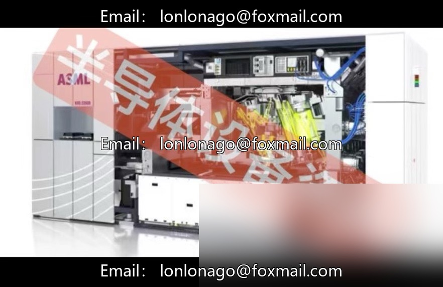
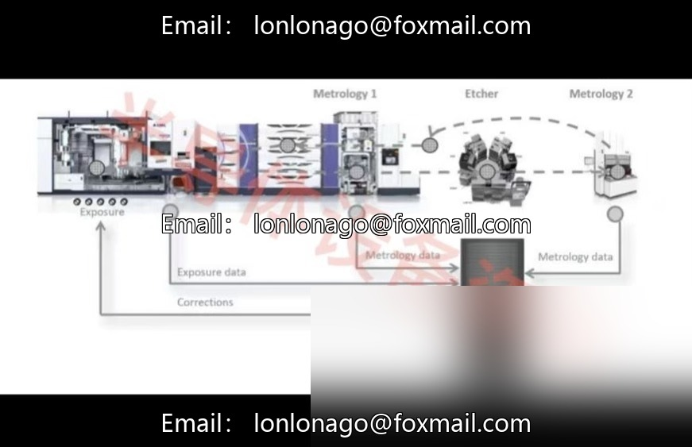
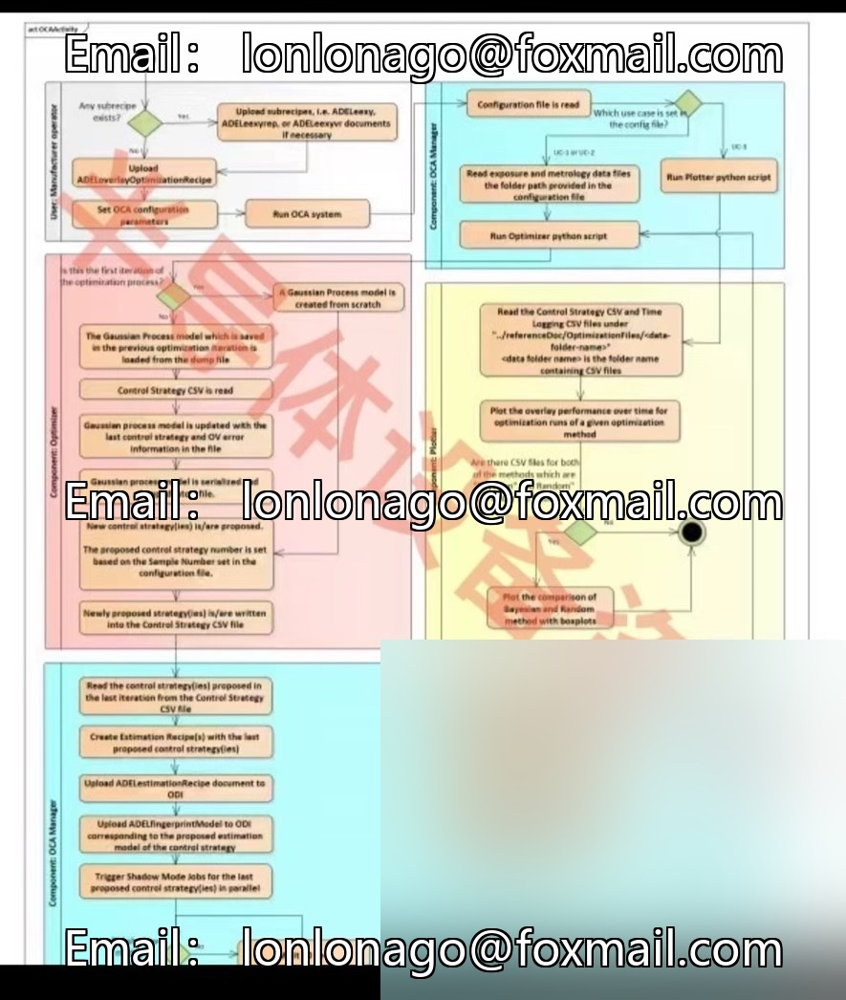
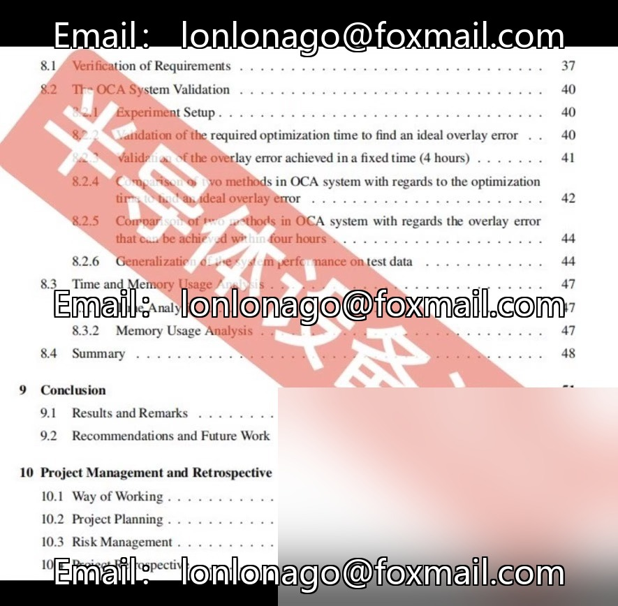
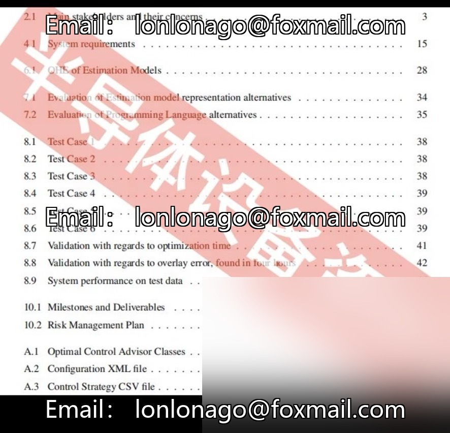
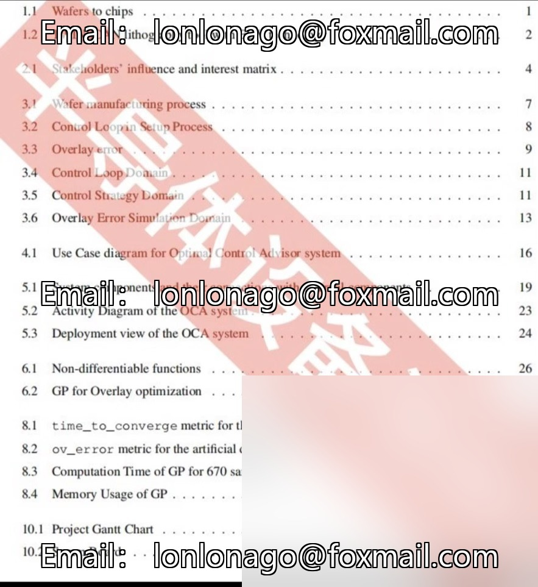

# ASML lithography machine cutting-edge technology: lithography machine process control strategies and selection, this technology

## Body

ASML lithographic machine cutting-edge technology: photolithographic machine process control strategies and selection This technology is based on Bayesian optimization. Currently the latest research technology! Extremely valuable! Internal materials! 100+ pages

The content covers ASML lithography technology, focusing on lithography process control strategies and selection, based on Bayesian optimization, with related documents, configuration, data and verification content.

<!-- AI_ENRICHED -->

## Images

## Payment

Here is a pay link on Stripe ( https://buy.stripe.com/3cs8yP7sY87d0vu9AB ). Please contact me lonlonago@foxmail.com after funding $89, and I will send you a complete data files , thank you!

